# CraftKit guide

[Back to README](../README.md) · [Diagram inventory and redraw notes](diagrams/README.md)

Detailed installation, workflow and authoring reference. The README is the starting point; command and skill files remain the workflow source of truth.

## Why bother?

CraftKit keeps project standards and workflows consistent across AI tools. RTK filters shell output; Caveman shortens responses; Ponytail asks the agent to delete unnecessary code. Savings depend on the work and are not guaranteed.

## Install

**Option A, npm** (version pinning + rollback):
```bash
npm install -g @raditia/craftkit
```

Pin a version or roll back:
```bash
npm install -g @raditia/craftkit@1.5.0
```

**Option B, git** (auto-update on `git pull`):
```bash
git clone git@github.com:raditia/craftkit.git ~/craftkit
cd ~/craftkit
bash install.sh
```

`install.sh` wires up the post-merge and post-rewrite hooks and runs the first sync. Merge and rebase pulls then add, update, and remove installed skills automatically. Existing git installations should rerun `bash install.sh` once to add the rebase hook.

**Requirements:** bash 3.2+, curl. macOS ships bash 3.2 by default.

**Upgrading from ≤ v1.23.0:** the next sync uninstalls the retired Copilot and Crush integrations automatically. Copilot `@` agents it wrote into your other repos may be committed there, so sync prints those paths and leaves them for you.

### Configuration: extras and gate groups

Every sync reads `~/.craftkit-state/config`, one `key=value` per line, so a choice made once holds through every `git pull` and npm upgrade. With no file, nothing changes from the defaults below. A fresh `bash install.sh` (no `~/.craftkit-state` yet) on a terminal shows the checklist, and an upgrade never prompts; `bash sync.sh --configure` shows it again and then syncs. Without a terminal (npm postinstall, post-merge, CI) nothing prompts and the saved file or the defaults apply.

| Key | Default | On | Off |
|-----|---------|----|-----|
| `humanizer` | on | Installs the humanizer skill on an explicit install | Removes `~/.agents/skills/humanizer` and the `~/.claude/skills/humanizer` link pointing at it, only when craftkit installed them; `/pr-message` and `/docs` report it skipped |
| `playwright` | off | `npm i -g @playwright/cli@latest`, then `playwright-cli install --skills=agents -g`. Needs npm and Node 20+, and network. Ownership is the skill folders that appear under `~/.agents/skills`, where the CLI is assumed to write them. A failed install warns, the sync completes, and later syncs skip it until `bash sync.sh --configure` or `bash install.sh` retries | Removes the skill folders craftkit's install added, and the npm package only if craftkit installed it |
| `dashboard` | off | The [agent dashboard](#agent-dashboard-opt-in) | Removes it, logs included |
| `gates.routing` | on | Skill-first and announce gates, the routing rule prose, the full routing hook | Unregisters `gate-skill-first.js` and `gate-announce-honored.js`, drops their rule prose, and the routing hook injects only the model-tier and local-skills lines, plus the director line while `gates.director` is on |
| `gates.director` | unset: Claude on, Codex off | Delegate gate and rule 12a on Claude and Codex | Unregisters `gate-delegate.js`, drops rule 12a and the hook's director line everywhere, and keeps the Codex gate off |
| `gates.verify` | on | Stop-hook verify gate on Claude and Codex | Unregisters `gate-verify-on-stop.js`, skips the Codex Stop check, drops their rule prose |

```bash
printf 'gates.verify=off\nplaywright=on\n' >> ~/.craftkit-state/config
bash sync.sh                        # applies it; a second run reports no work
CRAFTKIT_GATES_VERIFY=on bash sync.sh   # CRAFTKIT_<KEY> (dots as _) beats the file until the next sync
```

An env var beats the file for the rendered install and the `~/.craftkit-state/gate-*` files the hooks read at runtime. It leaves the config file unchanged; the next sync without the override restores the saved choices. `CRAFTKIT_DASHBOARD` is the exception and saves its value, as it always has; `~/.craftkit-state/dashboard` mirrors `dashboard=on` so a rollback to v1.58.0 keeps the dashboard. An unknown key or a value other than on/off warns once and keeps the prior setting. Gate prose lives in `<!-- BEGIN CRAFTKIT-GATE-<GROUP> -->` blocks that every tool's install strips when the group is off. A gate's Codex hook stays registered (one script serves every event) and reads the choice at runtime, so a change needs no new `/hooks` trust. A hook matcher you narrowed is saved when its gate goes off and put back when it returns.

**Contributing to craftkit itself:** see **[CONTRIBUTING.md](../CONTRIBUTING.md)**. Short version:
there is no application build (the product is instructions); behavioral fixtures run through `check.sh`, so `check.sh` is the gate and a second
consecutive `sync.sh` must report no work.
```bash
bash check.sh   # content integrity, exit 0 required before commit
bash sync.sh    # distribute; a second consecutive run must report no work
```

---

## How it works

Every `git pull` triggers a sync that installs rules, skills, commands, and agents into each AI tool:


[Diagram source](diagrams/sync-engine.html).

Five namespaces, one source of truth:

| Directory | Loaded | Invoked |
|-----------|--------|---------|
| `rules/` | Every session, automatically | Never, since they are always present |
| `skills/` | On demand | Slash command or natural language |
| `commands/` | On demand | Slash command or natural language |
| `agents/` | Spawned by an orchestrator | native spawning with the named profile (Claude and Codex) |
| `partials/` | Only as a splice into a skill, command or agent | Never, since it ships inside its host file (every tool for a skill or command, Claude and Codex for an agent) |

### At runtime: Gateway, Orchestrators, state

`sync.sh` is the **Distributor**: it runs at install time and never while you work. At runtime three
layers act inside each AI tool:

| Role | What | Where |
|------|------|-------|
| **CraftKit Gateway** | Claude uses the [routing, loader, guard, and exit hooks](#enforcement-gates-hooks-that-refuse). Codex loads applicable rule bodies at SessionStart, injects routing guidance on each prompt, and checks verification at Stop. | `hooks/`; Claude and Codex use native hooks. Cursor and Gemini get advisory text. Codex and Cursor discover skills from `~/.agents/skills/` |
| **Orchestrators** | Run a workflow: resolve the feature once in Phase 0, pass the slug down, spawn skills and agents | `commands/*.md` |
| **Skills and agents** | Do one job; skills reach Figma and Lark through the host's MCP client | `skills/`, `agents/` (Claude and Codex) |

The Gateway does not see MCP calls. Per-feature state lives in the repo, never in a tool:


[Diagram source](diagrams/runtime.html).

### Where files land per AI tool

| Tool | Always-on (`rules/`) | On-demand (`skills/` + `commands/`) | Agents (`agents/`) |
|------|----------------------|--------------------------------------|--------------------|
| Claude Code | `~/.claude/CLAUDE.md` (managed block) | `~/.claude/commands/<name>.md` → `/<name>` | `~/.claude/agents/<name>.md` |
| Cursor | `~/.cursor/rules/*.mdc` (alwaysApply) | `~/.agents/skills/<name>/SKILL.md` (shared native skills, local only) | n/a |
| Gemini CLI | `~/GEMINI.md` (managed block) | `~/GEMINI.md` (managed block), and also lists the shared `~/.agents/skills/` | n/a |
| Codex CLI | `~/.codex/AGENTS.md` (short managed block); `~/.codex/hooks.json` loads applicable full rules from `~/.craftkit/codex/rules/` at session start | `~/.agents/skills/<name>/SKILL.md` (shared native skills, including workflows) | `${CODEX_HOME:-~/.codex}/agents/<name>.toml` |

Codex and Cursor read skills from `~/.agents/skills/`, so they share one install there. Cursor does not copy that folder to Cloud Agents, so CraftKit skills reach local Cursor sessions only. Gemini CLI reads it too, but keeps its full `~/GEMINI.md` block: as native skills, workflows would load only on demand, behind a consent prompt on every activation. CraftKit's named specialists install for both Claude and Codex. Codex profiles carry the live injected instructions, use a read-only sandbox, and inherit the configured model with medium reasoning effort. Parallel workflows use native spawning up to the available concurrency, queue excess workers, and collect every result. Sequential fallback applies when spawning is unavailable. Unowned or symlinked Codex profiles are preserved and reported as collisions.

If a skill name already belongs to another install in `~/.agents/skills/`, sync leaves that directory untouched, warns with its path, and continues installing the other skills. Remove or rename the conflicting directory if you want CraftKit's version of that skill.

**Retired:** GitHub Copilot and Crush (supported through v1.23.0). Neither has a headless entry point, so neither can join cross-tool agent fan-out ([more](../docs/design-notes.md#retired-tools)).

---

## Using the workflows

### Just say what you want

Natural language routes to the right command automatically. No slash commands required.

```
"plan this feature"     →  /define   (interview → spec → test-cases → plan, checkpoint-gated)
"review this"           →  /parallel-review
"build this feature"    →  /parallel-build
"ship this"             →  /parallel-ship
"fix this bug"          →  /fix
"write tests for this"  →  /fe-test · /android-test · /ios-test  (by platform)
"generate PR message"   →  /pr-message
"poke holes in my plan" →  /grill     (also: "grill this", "stress-test my design")
"research X for me"     →  /research  (background agent, primary sources)
"hand this session off" →  /handoff   (also: "summarize for the next agent")
"connect our docs repo"  →  /context-source  (also: "which docs repos are connected", "disconnect the old docs repo")
```

Platform is not inferred. On every prompt `hooks/craftkit-routing.js` resolves it from `cwd` and injects the answer:


[Diagram source](diagrams/platform-routing.html).

Nearest ancestor wins, so `"write tests for this"` in an Android repo resolves to `/android-test`, never `/fe-test`.

---

### Enforcement gates: hooks that refuse

Routing context is only text: an agent can read it, announce the right skill, and hand-roll the work anyway. These hooks close that gap. The five gates can stop a call; the other four only inject context, rewrite a command, or notify.

Codex installs [`craftkit-codex.js`](../hooks/craftkit-codex.js) into `~/.codex/hooks/` and registers `SessionStart`, `UserPromptSubmit`, `PreToolUse` on `Bash|apply_patch|spawn_agent`, `PostToolUse` on Bash, and `Stop` in `~/.codex/hooks.json`. It loads applicable rule bodies, using a concise Codex routing section instead of the full Claude-oriented rule. An explicit `$skill` or leading `/command` request points to the native skill file without injecting a second body. Verification requires a completed successful command against an unchanged snapshot from start to finish and the latest edited state, including committed edits; parallel hook results append without overwriting peers. Unknown or unfinished results do not count. A PreToolUse rewrite runs verification through the Codex hook runner, which records the real process exit and matching snapshots even when execution yields and is collected with `write_stdin`; raw stdout never proves success. Direct foreground commands and `&&` chains are supported; commands that mask failures with pipelines or semicolons require a separate check invocation. The gate covers `check.sh`, Node type/lint checks, Gradle lint/tests, and iOS tests/SwiftLint. Codex requires a one-time **`/hooks` review and trust** of the new definitions before they run. Native skill activation is not exposed as a stable hook event, so the gateway cannot prove that a skill body was followed; verification is the enforced part. With `CRAFTKIT_DELEGATE=on` it also carries the `gate-delegate.js` rule for Codex: from the 3rd distinct source file a main-session turn edits (`apply_patch` paths, a rename counted once at its destination, plus shell writes parsed the same way), each edit is denied with a reason to delegate through `spawn_agent` with a verify contract, then `wait_agent` and integrate, until the turn spawns an agent that can edit (a CraftKit read-only profile named in `agent_type` does not count). It is opt-in because Codex rejects a PreToolUse `ask` as unsupported, so it can only deny, and no hook payload tells a `codex exec` run from an interactive one. Subagent calls (payload `agent_id`) pass. `CRAFTKIT_GATE=off` disables it all.

| Hook | Event | What it does |
|------|-------|--------------|
| [`craftkit-routing.js`](../hooks/craftkit-routing.js) | `UserPromptSubmit` | Injects the routing table, platform, model tiers, and any locally installed skills. Advisory |
| [`gate-skill-first.js`](../hooks/gate-skill-first.js) | `PreToolUse` on `Edit\|Write\|MultiEdit\|NotebookEdit` | Asks before a source edit in a session that never invoked a skill, naming the skills that fit the file. Once per turn |
| [`gate-delegate.js`](../hooks/gate-delegate.js) | `PreToolUse` on `Edit\|Write\|MultiEdit\|NotebookEdit\|Bash` | Asks on the 3rd distinct source file a main-session turn edits and on every source edit after it (shell writes such as `sed -i` count; parallel calls count through its own per-turn record), telling the agent to hand the work to a background agent with a verify contract (director mode). Passes subagents, notifications, planning docs, unattended sessions (`claude -p`, where an ask is auto-denied), and any turn that has handed the work to an agent (a background spawn, or one whose profile can edit; a foreground `Explore` or read-only reviewer does not count). Counts only `.ts/.tsx/.js/.jsx/.mjs/.cjs/.kt/.java/.swift/.m/.mm`, so `.py` and notebooks (`.ipynb`) are not gated. `CRAFTKIT_DELEGATE=off` turns it off |
| [`gate-verify-on-stop.js`](../hooks/gate-verify-on-stop.js) | `Stop` | Blocks a turn that edited source but ran no verification command, and names the command (`check.sh` if present, else typecheck + lint). On a background-agent notification turn it counts files dirtied since that agent spawned, ignoring agent worktree dirs, and passes when the agent's own transcript (`<session>/subagents/agent-<task-id>.jsonl`) shows the verify command succeeding after its last write. Edits outside the repo root do not count |
| [`gate-announce-honored.js`](../hooks/gate-announce-honored.js) | `Stop` | Blocks a reply that says `Running /<skill>` with no `Skill` call, or carries no routing declaration at all |
| [`gate-read-size.js`](../hooks/gate-read-size.js) | `PreToolUse` on `Read` | Refuses a whole-file read over 800 lines and points to the `bulk-read` agent or an `offset`/`limit` read. Denies rather than asks |
| [`craftkit-platform-rules.js`](../hooks/craftkit-platform-rules.js) | `SessionStart` | Loads `platform:`-scoped rules only where the cwd matches, so EVPMR laws stay out of Kotlin and Swift sessions |
| [`craftkit-update-check.js`](../hooks/craftkit-update-check.js) | `SessionStart` | Tells you when a newer craftkit is on npm. Asks the registry at most once a day (1.5s timeout, cached in `~/.craftkit-state/update-check`) and stays silent on any failure |
| [`craftkit-read-cap.js`](../hooks/craftkit-read-cap.js) | `PreToolUse` on `Bash` | Rewrites a bare `cat F` / `rtk read F` over 800 lines to `rtk read -m 800`. Leaves piped commands alone |

Shared helpers (not registered as hooks): [`craftkit-transcript.js`](../hooks/craftkit-transcript.js) finds the current turn for every gate, [`craftkit-platform.js`](../hooks/craftkit-platform.js) detects the platform, [`craftkit-filesize.js`](../hooks/craftkit-filesize.js) holds the 800-line threshold, and [`craftkit-drift.js`](../hooks/craftkit-drift.js) answers "has this changed since baseline" as clean, drifted, or cannot-verify.

How the gates behave:

- **Fail open.** Unreadable transcript, bad stdin, or no gate command in the project: the call passes.
- **`ask`, not `deny`,** so you keep the override. The Read gate is the exception, because an `ask` is silently approved under auto-accept.
- **Subagents are checked at the parent.** Their edits pass inside the agent; the parent's Stop gate picks them up from `git status`, the same way it catches edits made with `sed -i` or a heredoc.
- **Skill gate is per session, Stop gates are per turn.** A turn continuing already-routed work ("apply the fixes") isn't asked again.
- **A downgrade refuses to sync.** `sync.sh` won't run from a checkout older than the installed version.
- **Plugin skills** (`<plugin>:<name>`) aren't enumerated by the announce gate and pass.

| Escape hatch | Turns off |
|--------------|-----------|
| `gates.routing` / `gates.director` / `gates.verify` = `off` in `~/.craftkit-state/config` | That group's hooks and rule prose, for good. See [Configuration](#configuration-extras-and-gate-groups) |
| `CRAFTKIT_GATE=off` | The four edit/Stop gates and platform-rules injection |
| `CRAFTKIT_DELEGATE=off` | `gate-delegate.js` only. Unattended `claude -p` runs already skip it; set this for any other automation that cannot answer an ask. On Codex the gate is off unless `CRAFTKIT_DELEGATE=on`; an explicit `gates.director` in the config wins over it |
| `CRAFTKIT_READ_GATE=off` | `gate-read-size.js` |
| `CRAFTKIT_READ_CAP=off` | `craftkit-read-cap.js` |
| `CRAFTKIT_ALLOW_DOWNGRADE=1` | The sync downgrade guard |
| `CRAFTKIT_UPDATE_CHECK=off` | `craftkit-update-check.js` |

Removing a Claude hook from `_CRAFTKIT_HOOKS` uninstalls it on the next sync. The reasoning behind each behavior above, with the measurements: [design notes](../docs/design-notes.md#enforcement-gates).

### Agent dashboard (opt-in)

A live terminal view of what your agents are doing: the main session (model, effort, context, cost), a box for each running subagent that appears when it starts and disappears when it finishes (model, tokens used, elapsed time, tool calls, current action), a total of the tokens all its subagents used, and a session log. Model and tokens come from Claude Code's own subagent transcripts; Codex boxes show the model its events carry, and no tokens, because its transcript format is not a stable interface. It covers Claude Code and Codex sessions, several at once: a strip at the top lists every session active in the last 30 minutes and not ended (tool, project folder name, a short session id so two sessions in one project differ, running subagents, last event), numbered in the order they started. `←`/`→` or `1`-`9` switch and pin the view, `a` goes back to following the newest, and `ccdash <n>` opens a window pinned to session `n`: the number is turned into that session's id before the window opens, so it keeps watching that session when the strip renumbers. Inside tmux a pinned view opens as a side-by-side pane; on macOS each is its own window. A session with no tool call yet, or none in 30 minutes, is not listed.

Example, from sample data (two sessions, the second pinned, three subagents running and one finished):

```text
CLAUDE CODE AGENT TREE  ·  agentic-skills  ·  a91c4f  ·  live  ·  pinned
   1 ○ Codex  booking-web            b7e210  idle       live
▸  2 ● Claude agentic-skills         a91c4f  3 running  live
  ←/→ or 1-9 switch · a follow newest

╭──────────────────────────────────────────────────────────╮
│ Opus 5.5 · main session                                  │
│ effort high   ctx ███░░░░░░░ 38%   $2.41                 │
│ last: Read scripts/dashboard.py                          │
╰──────────────────────────────────────────────────────────╯
      │
      ├─ 3 subagent(s) running · 1 done · subagents used 169.1k tokens
╭────────────────────────────╮  ╭────────────────────────────╮  ╭────────────────────────────╮
│ code-quality               │  │ adversarial                │  │ ponytail-review            │
│ ◐ running  2m14s           │  │ ◐ running  1m58s           │  │ ◐ running  1m31s           │
│ sonnet-5-5                 │  │ opus-5-5                   │  │ sonnet-5-5                 │
│ 41.8k tok · 1.6k out       │  │ 98.7k tok · 2.4k out       │  │ 19.1k tok · 700 out        │
│ 1 tool call(s)             │  │ 1 tool call(s)             │  │ 1 tool call(s)             │
│ Read sync.sh               │  │ Read ccdash                │  │ Grep agent_usage           │
╰────────────────────────────╯  ╰────────────────────────────╯  ╰────────────────────────────╯

── session log ───────────────────────────────────────────────────────────────────────────
22:40:02  main            Read scripts/dashboard.py
22:40:09  code-quality    started
22:40:14  code-quality    Read sync.sh
22:40:21  ponytail-revi…  started
22:40:30  ponytail-revi…  Grep agent_usage
22:40:36  adversarial     started
22:40:44  adversarial     Read ccdash
22:41:03  bulk-read       started
22:41:40  bulk-read       finished

9 events  ·  esc / q to close
```

```bash
CRAFTKIT_DASHBOARD=1 bash sync.sh   # turn on; saved as dashboard=on in ~/.craftkit-state/config
ccdash                              # open it, following the newest session; esc or q closes it
ccdash 2                            # open pinned to session 2 (one window per session: ccdash 1, ccdash 2, ...)
CRAFTKIT_DASHBOARD=0 bash sync.sh   # turn off; removes everything it installed
```

Installed with npm, set the same variable on the install; later upgrades keep the choice:

```bash
CRAFTKIT_DASHBOARD=1 npm install -g @raditia/craftkit   # turn on
CRAFTKIT_DASHBOARD=0 npm install -g @raditia/craftkit   # turn off
```

Then start a new Claude session so the hooks load, and in Codex run `/hooks` once to trust the new one.

It is off by default because the logger writes the first 60 characters of every tool call's file path or command to `~/.craftkit/agent-tree/events/`. Those files are private to you (`0600`), common credential shapes (auth headers, `--password x`, `token=`, `*_SECRET_*=`, `-u user:pass`, `https://user:pw@`, `sk-`/`ghp_`/`xoxb-`/`AKIA` tokens) are masked before writing (shape-based, so it narrows exposure rather than guaranteeing none), the logger deletes files older than 7 days, and turning the dashboard off deletes the directory. Off installs nothing. `CRAFTKIT_DASHBOARD` also takes `on`/`off`, `true`/`false`, `yes`/`no`; anything else is warned about and ignored.

| Piece | Where | What it does |
|-------|-------|--------------|
| [`craftkit-agent-log.js`](../hooks/craftkit-agent-log.js) | Claude and Codex, on `SubagentStart`, `SubagentStop`, `PostToolUse`, `SessionEnd` | Appends one line per event to the session's log and keeps a file per running subagent, deleted when it stops and cleared when the session ends. Fails open. Codex needs a one-time `/hooks` trust |
| [`craftkit-statusline.js`](../hooks/craftkit-statusline.js) | Claude `statusLine` | Shows model, effort, context, cost and running subagents, and saves them for the dashboard. If you already have a status line it is kept: saved to `~/.craftkit-state/statusline.json`, run first with the same input, and this is appended after it. Turning the dashboard off puts yours back exactly |
| [`scripts/dashboard.py`](../scripts/dashboard.py), [`scripts/ccdash`](../scripts/ccdash) | `~/.craftkit/bin`, linked into `~/.local/bin` when that exists | The viewer and its launcher. `ccdash` opens a tmux popup inside tmux (a side pane before tmux 3.2), a separate iTerm or Terminal window when run from a chat (`! ccdash`, macOS), or full screen in a plain terminal. Without a terminal it prints one snapshot |

Cost, measured on a 20,000-event log: the logger and status line each finish in under 0.1s, but they are a `node` start per tool call and per status refresh (5s) while the dashboard is on. The open dashboard idles near 0% CPU and ~20 MB, because it keeps one state per session and reads only the lines added since its last frame. A subagent quiet for 30 minutes (one long build or test run looks the same) is labelled `quiet` rather than dropped. If Codex misses a stop hook, the dashboard also checks the last 64 KB of its worker transcript for an explicit task completion, including failures; a resumed task appears again. Missing or unfamiliar transcripts keep the box visible. One killed before its `SubagentStop` fires is cleared when its session ends, or hidden after a day if the session was killed too. Turning the dashboard off while a session is open makes that session report a missing hook on each tool call until it restarts.

---

### Dynamic workflows (default)

Build, review, and ship use **dynamic parallel execution**: a classifier detects the platform (RN/web, Android, iOS), reads your actual diff, selects only the agents that matter, and runs them concurrently. Test-only diffs skip deep review entirely. Every command below works on all three platforms; only the gates and the agent set change.

The diagrams summarize handoffs and decisions. These roles apply throughout:

| Role | Meaning |
|---|---|
| You | Describe the goal and inspect the result |
| Hooks | Load context and enforce configured gates |
| Main agent | Implement, coordinate and verify |
| Subagents | Review independently without editing |
| Verdict | State readiness, blockers or coverage gaps |

#### /parallel-review

> Triggered by: `"review this"` / `"help me review"` / `"code review"` / `"LGTM check"`


[Diagram source](diagrams/parallel-review.html).

#### /parallel-ship

> Triggered by: `"ship this"` / `"prepare for PR"` / `"is this ready?"` / `"get this ready to merge"`


[Diagram source](diagrams/parallel-ship.html).

#### /parallel-build

> Triggered by: `"build feature X"` / `"implement X"` / `"create a new screen"`


[Diagram source](diagrams/parallel-build.html).

#### How findings become one verdict

Every review agent reads the same files in the same message and shares nothing, so agreement between them is evidence:


[Diagram source](diagrams/synthesis.html).

---

### How the classifier picks agents

The classifier reads your actual changed files, not just filenames, and selects only the agents that apply. Irrelevant agents are skipped entirely.

```
RN / web (EVPMR)                         agents selected:
──────────────────────────────────────────────────────────
View*.tsx                           →   code-quality + fe-review + fe-a11y
Presenter*.ts                       →   code-quality + fe-review
Model*.ts                           →   code-quality (type/correctness focus)
Entry*.tsx or Resource*.ts          →   fe-review
View or Presenter + /parallel-ship  →   + fe-performance

Android (MVP)
──────────────────────────────────────────────────────────
*Activity/Fragment/Widget.kt, layout →  code-quality + android-review + android-a11y
*Presenter.kt, *ViewModel.kt         →  code-quality + android-review
*Repository/Interactor/UseCase.kt    →  code-quality
Dagger *Module/*Component.kt         →  android-review
Presenter/VM/adapter + /parallel-ship → + android-performance

iOS (MVVM-C)
──────────────────────────────────────────────────────────
*ViewController/View/Cell.swift      →  code-quality + ios-review + ios-a11y
*ViewModel.swift                     →  code-quality + ios-review
*Fetcher.swift                       →  code-quality + ios-performance
*Contract/Factory/Coordinator.swift  →  ios-review

All platforms
──────────────────────────────────────────────────────────
any non-test src + build/ship       →   + ponytail-review (over-engineering)
3+ architecture layers changed      →   + adversarial (devil's advocate)
auth / payment / credential paths   →   code-quality (security emphasis)
intent file resolves under docs/planning/  →   code-quality (spec conformance: diff vs planned acceptance criteria)
test files only                     →   agents skipped, gates only
```

Five example diffs and what the classifier picks for `/parallel-review`:

| Example diff | Agents picked | Why |
|---|---|---|
| `ViewCheckout.tsx` + `PresenterCheckout.ts` | code-quality · fe-review · fe-a11y | a View changed, so a11y joins |
| `ModelCheckout.ts` only | code-quality (type-safety focus) | targeted findings, no EVPMR or a11y noise |
| `__tests__/ViewCheckout.test.tsx` only | none: gates only (tsc + lint + test) | tests only, so Phase 2 is skipped and costs no agents |
| Entry + View + Presenter + Model | code-quality · fe-review · fe-a11y · adversarial | 3+ layers changed, so adversarial argues against merging |
| `CheckoutFragment.kt` + `CheckoutPresenter.kt` (Android) | code-quality · android-review · android-a11y · android-performance | same command, native agents; gates are `gradlew lint` + `testGeneralDebugUnitTest` |

---

### Sequential fallback

When you want a lightweight, single-pass run, use the explicit slash command.

| Command | When to prefer |
|---------|---------------|
| [`/review`](../commands/review.md) | Quick sanity check, small diff |
| [`/ship`](../commands/ship.md) | Simple pre-merge gate, tests already passing |
| [`/build`](../commands/build.md) | Scaffold-only, no parallel validation needed |

They are also the automatic substitute wherever subagents can't be spawned:


[Diagram source](diagrams/fallback.html).

`check.sh` verifies each twin exists and is mapped in both the rule and the routing hook.

---

### Planning pipeline: /define, before you build

`/define` runs `/interview` (de-fuzz the ask) → `/spec` (PRD) → `/test-cases` (QA cases from Figma/Lark, approved by you) → `/plan` (tasks), pausing for your approval after each, so a bad spec can't quietly turn into bad tasks. It offers `/ideate` when the approach is open and `plan-roaster` before build. The result goes into `docs/planning/<slug>.md`, which every execution skill reads.


[Diagram source](diagrams/planning.html).

It stops at a reviewed plan. `/adr` and `/docs` come later, offered at the end of `/parallel-ship` once the code is final. Each planning skill also runs on its own. To challenge a plan you already have, use `/grill` (interactive) or the `plan-roaster` agent (one shot).

---

### Experimental: /team-build, agent teams

> Built on Claude Code's experimental [agent teams](https://code.claude.com/docs/en/agent-teams). Requires `CLAUDE_CODE_EXPERIMENTAL_AGENT_TEAMS=1`. Explicit `/team-build` only, since saying "build feature X" still routes to `/parallel-build`.

Your session becomes a **team lead**: it plans the work, then spawns teammates that build different files at the same time and message each other directly, working off a shared task board.

| | `/parallel-build` (default) | `/team-build` (experimental) |
|---|---|---|
| Who writes the code | The main session, one file at a time | Two implementer teammates, in parallel |
| Helpers | One-shot reviewers that report back once | Persistent teammates that claim tasks and message each other |
| Coordination | None needed | Shared task board; finishing one task unblocks the next |
| Model split | One session model | Lead on escalated (`opus`), teammates on everyday (`sonnet`) |
| Token cost | ~1× | ~5× |
| Best for | Most features | Larger multi-file features where parallel implementation pays for the overhead |

- **One file, one owner** for the whole build, so nobody overwrites anyone. Teammates ask each other directly (the Presenter owner asks the Model owner about a type) instead of going through the lead.
- **Staged spawn.** The reviewer and tester start only once there is something to review or test.


[Diagram source](diagrams/team-build.html).

Works on RN/web, Android and iOS; the task board follows each platform's file layout.

- **Claude Code only.** Teams are a harness feature, so on other tools the preflight falls back to `/parallel-build` or `/build`.
- **~5× the tokens** of a solo build.
- **Teammates don't survive `/resume`.** An interrupted build restarts coordination from the task board.

Full workflow: [`commands/team-build.md`](../commands/team-build.md).

---

### Cross-model: /cross-review

Claude and Codex review the same diff without seeing each other's work, then each answers the other's findings once. Your session reads both rounds and keeps what the evidence supports. Explicit `/cross-review` only.


[Diagram source](diagrams/cross-review.html).

| Step | What happens |
|---|---|
| Preflight | Both CLIs present, both auth methods on the allowlist for this project, tracked diff captured and under 256 KiB. Any miss stops the run before anything is sent |
| Round 1 | Both CLIs get the same prompt and diff, blind to each other (`claude -p --restricted --strict-mcp-config` with Read/Grep/Glob, `codex exec --ignore-user-config -s read-only`) |
| Round 2 | Each marks every one of the other's findings AGREE, DISPUTE or CANNOT-VERIFY, and may withdraw its own |
| Validate | Replies must parse and answer every peer finding; the tracked diff and untracked path list must be unchanged since the start |
| Synthesis | The host keeps consensus, settles disputes by reading the cited lines, labels the rest |

- **Both CLIs are required.** If either is missing or fails, the run stops with `cross-review could not run: …` instead of quietly becoming a same-model review.
- **Only one critique round.** More rounds make the models drift toward agreement rather than evidence.
- **Account safety.** Before any diff is sent, `~/.craftkit/cross-review-allowed-auth` must hold a `project=/absolute/path` line for this repository (one line per approved project) plus the exact methods allowed for both CLIs, for example `claude=claude.ai` and `codex=Logged in using ChatGPT`. `CRAFTKIT_CROSS_REVIEW_POLICY` points at a different file. The CLIs expose the login method, not the account, so confirm the signed-in accounts are approved. Auth checks and panelist calls clear API keys, alternate endpoints and provider override variables; Codex also ignores user configuration.
- **Scope.** Tracked changes since the merge base, including working-tree edits. Untracked files are never sent, only counted, since an unignored `.env` is exactly the file nobody meant to share. Binary diffs name the file without reviewable contents.
- **Layout-tolerant, content-strict.** Code fences, a preamble, wrapped lines and lowercase severities are accepted; a line that does not parse, or a critique that skips a peer finding, stops the run with the raw replies kept for inspection.
- **Reproducible.** Each run keeps the diff, the exact prompts, both CLI versions and the commit in a unique owner-only directory under `~/.craftkit-state/cross-review/`.
- Panelists run with `CRAFTKIT_PANELIST=1` (the script refuses to start inside one, and the routing hook stays silent) and `CRAFTKIT_GATE=off`, so the Stop gates cannot block a headless reviewer.

Script: [`scripts/cross-review.sh`](../scripts/cross-review.sh), installed to `~/.craftkit/bin/`. Workflow: [`commands/cross-review.md`](../commands/cross-review.md).

---

### Fix, tests, and PR message

```
"something is broken" / "fix this bug" / "this crashes"
  /fix  →  fe-context → reproduce → isolate → fix → regression test

"write tests" / "add tests" / "coverage is low"     → resolves platform first
  /fe-test       →  RN/web: write tests for all changed paths, enforce ≥93% coverage
  /android-test  →  JUnit + MockK Presenter tests (no fixed coverage bar)
  /ios-test      →  Quick + Nimble ViewModel specs (no fixed coverage bar)

"generate PR message" / "draft a PR" / "what should my PR say"
  /pr-message  →  read diff → write title + summary + goal + changes + coverage → humanize (if installed) → copy to clipboard
```

---

### Grill, research, and handoff

Three general-purpose skills adapted from [mattpocock/skills](https://github.com/mattpocock/skills) (MIT). All natural-language routed; none auto-run.

```
"poke holes in my plan" / "grill this" / "stress-test my design"   → needs an EXISTING plan
  /grill  →  map plan as design tree → ask whole frontier per round (each ❓ with ➡️ recommended
             answer) → sub-agents fetch facts, you only decide → done when frontier empty.
             Side effects: resolved terms → docs/glossary.md · hard-to-reverse decisions → offers /adr

"research X for me" / "find out how the Y API works" / "dig into the docs"
  /research  →  background agent reads PRIMARY sources only (official docs, source code, specs)
                → cited Markdown note in the repo → you keep working meanwhile

"hand this off" / "summarize this session for the next agent" / "wrapping up for today"
  /handoff  →  handoff doc in OS temp dir: goal, verified state, decisions + why, ordered next
               steps, suggested skills. Links existing artifacts by path, never duplicates. Secrets redacted.
```

Picking the right interrogator:

| You have | You want | Use |
|----------|----------|-----|
| A fuzzy new ask, no plan | Requirements extracted | `/interview` (one question at a time) |
| An existing plan/decision | It challenged, interactively | `/grill` (frontier rounds) |
| A finished plan doc | A cold second opinion, one shot | `plan-roaster` agent |

---

### Scoring a run: /eval

Reviews say what is wrong. `/eval` says how much was right, as one number you can track across runs.

```
"score this run" / "how correct was that" / "what is our success rate"
  /eval  →  gathers diff + PLANNING acceptance criteria + gate results
         →  spawns eval-judge (cold) → five criteria, each 0-5, each weighted
         →  recomputes the weighted sum in awk (judgment is the model's, arithmetic is not)
         →  appends a row to docs/evals/ledger.md → derives the running success rate
```

| Criterion | Weight | Scored on |
|---|---:|---|
| Spec conformance | 35 | Every PLANNING acceptance criterion actually implemented |
| Correctness | 25 | Edge cases, error paths, no crash or data-loss path |
| Pattern adherence | 20 | EVPMR / MVP / MVVM-C contract holds |
| Verification | 15 | Tests cover changed paths and pass; type + lint clean |
| Simplicity | 5 | Ponytail rubric: nothing to delete |

`Correctness % = Σ (score / 5 × weight)`, so `5·4·4·3·5` is 85.0%. Bands: `≥90 PASS` · `75-89 PASS WITH GAPS` · `<75 BLOCKED`.

The scorer is built so a number can't hide a failure:

- **Floors beat the band.** Any criterion at 0, or Spec conformance / Correctness at 2 or below, is `BLOCKED` whatever the total. Otherwise "perfect except it doesn't do what was asked" still scores 85%.
- **Unscorable is a gap.** With no intent file, Spec conformance is `n/a` and the verdict is `INCOMPLETE`, reported out of the remaining 65 points instead of reweighted upward.
- **The success rate is computed from the ledger** each time, never stored.
- **Optional hard gate:** put a `**Threshold:**` line in the ledger header and `/eval` uses it instead of 90, which is the shape for CI. `/eval` itself only reports; it never blocks a merge or reverts.

---

## Skills reference

See the [skill catalog](../README.md#skills-reference) and [agent catalog](../README.md#agents-reference).

## Architecture (EVPMR)

All frontend features follow a strict 5-file module structure. Rules are enforced by `fe-rules` at all times, with no invocation needed.


[Diagram source](diagrams/evpmr.html).

```
View       NEVER  useState / useEffect / API calls
Presenter  NEVER  return JSX
Model      NEVER  import React or cause side effects
Entry      ALWAYS wrap in <ErrorBoundary>
Resource   ALWAYS own display strings, never hardcoded in View
Styles     ALWAYS StyleSheet.create() + Token.spacing.* / Token.color.*
```

Async data always as discriminated unions:
```ts
type AsyncData<T> =
  | { type: 'NOT_ASKED' }
  | { type: 'LOADING' }
  | { type: 'DATA_READY'; payload: T }
  | { type: 'ERROR'; error: string }
```

### How context flows between skills

[`partials/change-scope.md`](../partials/change-scope.md) supplies the shared collection contract: staged, unstaged, relevant untracked, and committed changes are unioned before classification. Base discovery uses local refs and reports `cannot-verify` when unavailable. No context cache is written.

Context comes in two halves (ADR-0001, ADR-0002):

| Half | What | Where it lives |
|------|------|----------------|
| **Derived** | What git knows: changed files, diff summary, patterns | Emitted into the turn by `/fe-context` (~800 tokens), never stored. A workflow derives it once and passes it down |
| **Intent** | What a human decided: spec, task plan, decisions | One file per feature at `docs/planning/<slug>.md`, with a human-owned `status:`. The active feature is found by globbing for `status: active`, so there is no index to go stale |


[Diagram source](diagrams/context-flow.html).

| Level | Source | What | Stale when |
|-------|--------|------|-----------|
| L1 Rules | Always-active rule files | EVPMR, tokens, Karpathy guidelines | Never; loaded fresh each session |
| L2 Intent | `docs/planning/<slug>.md` | What's being built, constraints, decisions | The author changes their mind, so `status:` is theirs to set |
| L3 Derived | derived into the turn | Files touched by this branch, as git reports | Cannot be stale; nothing is stored (ADR-0002) |
| L4 Errors | On demand | Failing tests, lint, TypeScript errors | n/a, always live |
| L5 History | Session | Conversation context | n/a |

Every skill that reads intent uses one resolver, `partials/planning-resolve.md` ([why](../docs/design-notes.md#intent-resolution)). Test cases have one reader contract, `partials/test-cases-resolve.md` (approved rows only, never derived from the diff), and Figma/Lark sources one checker, `partials/external-sources.md` (markers, not content; `cannot-verify` when no MCP is reachable). Connected team docs repos have one consult step, `partials/context-source.md`, injected into `/interview`, `/spec`, `/plan` and `/define`: refresh once, search under a shared read budget, cite `<source>@<sha>:<path>:<line>`, pause on any conflict, and say `context source not consulted` rather than stay silent when the helper cannot run. Failing tests heal by one contract, `partials/test-heal.md`, injected into `/fe-test`, `/android-test` and `/ios-test`: each failure is classified before any edit, and an assertion changes only when an approved test case or Spec line states the new value.

---

## Model routing

Skills run on the everyday model and consult the escalate model inline when a question needs it, without stopping you.

On Claude Code, `hooks/craftkit-routing.js` resolves the tiers on every prompt from `~/.claude.json`: **your plan picks the tier window, your entitlements pick the ids inside it.**


[Diagram source](diagrams/model-routing.html).

A new model release needs no edit here: `opus-5` replaces `opus-4-8` as soon as the account is entitled to it. Only a brand-new family name touches the rank list. Personal plans are capped below the frontier family on purpose ([why](../docs/design-notes.md#model-routing)).

Skills name a tier, never a model id. Claude agents spawn on the family alias (`haiku` / `sonnet` / `opus` / `fable`), which tracks the newest model in that family. `check.sh` check 17 fails the build on a versioned id from any vendor.

| AI | Everyday | Escalate | Fusion panel |
|----|----------|----------|-------------|
| Claude Code | injected per prompt | injected per prompt | 2× escalate → same-tier judge |
| Gemini CLI | `flash` | `pro` | n/a |
| Cursor | `auto` (picker/account-level, not repo-configurable) | `cursor-agent --model` | n/a |
| Codex CLI | omit `model`, effort `medium` | omit `model`, effort `high` | n/a |

| Route to | When |
|----------|------|
| Escalate model | Architecture call with non-obvious tradeoffs, security-sensitive code, no hypothesis after 2 debug attempts |
| Fusion panel (2 independent escalate runs, then a judge) | Irreversible production changes, security architecture with real attack surface, decisions where one model may miss a reasoning path |

---

## Managing skills

**Edit source here, never the installed copies** in `~/.claude/`, `~/.cursor/`, `~/GEMINI.md`, `~/.codex/` or `~/.agents/skills/`. `sync.sh` overwrites those on the next pull.

### Add a rule (always-on)

```bash
# 1. create the file
echo '---\nname: my-rule\ndescription: What it enforces\n---\n\n...' > rules/my-rule.md

# 2. ship it
git add rules/my-rule.md && git commit -m "feat: add my-rule" && git push
# users: git pull → auto-installed
```

### Add a skill (on-demand)

> Not sure whether to add a skill or an agent? See [Skill vs agent](../README.md#skill-vs-agent-when-to-add-which).

```bash
mkdir -p skills/my-skill
# create skills/my-skill/SKILL.md with frontmatter: name, description, alwaysApply: false
git add skills/my-skill && git commit -m "feat: add my-skill" && git push
```

### Add a command (orchestrator)

```bash
# create commands/my-command.md with frontmatter: name, description
git add commands/my-command.md && git commit -m "feat: add my-command" && git push
```

### Add an agent (cold specialist for Claude and Codex)

```bash
# create agents/my-agent.md with frontmatter: name, description, tools, model, color
git add agents/my-agent.md && git commit -m "feat: add my-agent agent" && git push
# users: git pull → Markdown in ~/.claude/agents/ and TOML in ~/.codex/agents/
```

### Add a hook (Claude Code enforcement)

Drop the script in `hooks/`, add a `script%event%matcher%statusMessage` row to `_CRAFTKIT_HOOKS` in `adapters/claude.sh`, and document it in [Enforcement gates](#enforcement-gates-hooks-that-refuse). `check.sh` check 24 fails if any of the three is missing, in either direction. A gate must fail open and survive malformed stdin: check 23 asserts both, behaviorally.

### Remove a skill, command, or agent

```bash
git rm -r skills/<name>/       # skill
git rm commands/<name>.md      # command
git rm agents/<name>.md        # agent → also remove from subagent_type references in commands/
git commit -m "remove: <name>" && git push
# users: git pull → auto-uninstalled from all AI tools
```

---

## Tooling

External tools and inspirations bundled or adopted into this repo.

| Tool | Source | Purpose | How it's used |
|------|--------|---------|---------------|
| **RTK** | [github.com/rtk-ai/rtk](https://github.com/rtk-ai/rtk) | Filters shell output before it reaches the AI, for 60-90% input token savings | Auto-installed on `bash install.sh`. All commands prefixed with `rtk` |
| **Caveman** | [github.com/JuliusBrussee/caveman](https://github.com/JuliusBrussee/caveman) | Strips AI output verbosity, for 40-60% response token savings | Delivered by the caveman plugin's hooks (level tracking, stats). lite / full / ultra modes |
| **Ponytail** | [github.com/DietrichGebert/ponytail](https://github.com/DietrichGebert/ponytail) | YAGNI-first decision ladder + over-engineering audit, for 80-94% code reduction | Decision ladder in `karpathy-guidelines`, `ponytail:` comment convention, 3 skills: `/ponytail-review`, `/ponytail-audit`, `/ponytail-debt` |
| **graphify** | [github.com/Graphify-Labs/graphify](https://github.com/Graphify-Labs/graphify) | Turns the repo into a queryable knowledge graph (tree-sitter, local, no embeddings), so `/debug` and `/fe-performance` follow edges instead of grepping | Optional. Install **project-scoped only** (`graphify claude install`); global mode can eat the managed block ([why](../docs/design-notes.md#graphify)) |
| **Karpathy Guidelines** | [karpathy.ai](https://karpathy.ai), adapted | Behavioral rules to prevent LLM coding pitfalls: think before coding, surgical changes, goal-driven execution | Always-active via `rules/karpathy-guidelines.md` |

---

## Changelog

See **[CHANGELOG.md](../CHANGELOG.md)**, one `## vX.Y.Z` section per release, newest first.
`.github/workflows/release.yml` reads the version from this README's header and the matching
section of `CHANGELOG.md`, so a release updates both.
